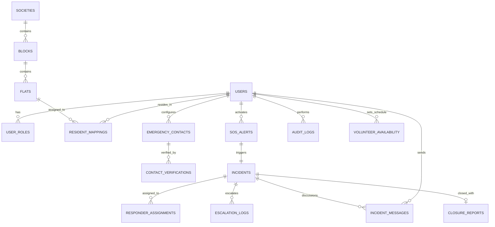
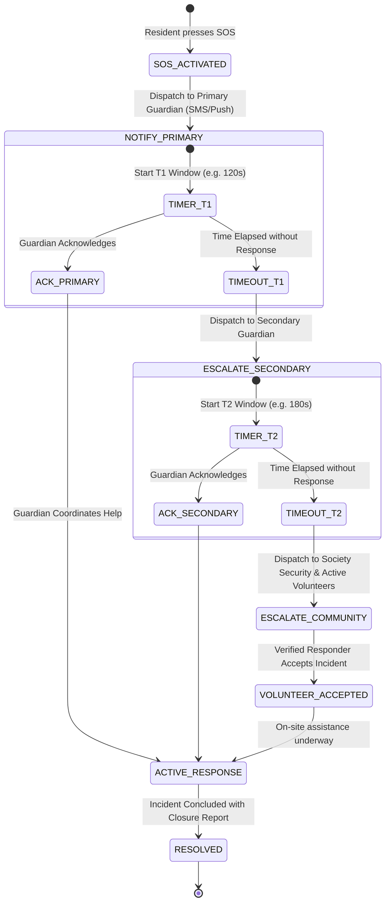

# Community Emergency Response Platform — Architecture & Design

## 1. Executive Summary & College Project Scope
The **Web-Based Community Emergency Response Platform with Network Assistance using Mobile App** is a mission-critical, multi-tier system engineered to coordinate emergency responses across residential societies, gated communities, and local networks.

The system bridges residents, primary/secondary guardians, verified community volunteers, and on-premises security guards through low-latency REST APIs, automated guardian escalation timelines, and role-based incident dashboards.

---

## 2. System Architecture Diagram

```
+-----------------------------------------------------------------------------------+
|                                 CLIENT APPLICATIONS                               |
|                                                                                   |
|   +-------------------------------+       +-----------------------------------+   |
|   |   React + TypeScript Web      |       |  React Native / Expo Mobile App   |   |
|   |  - Society & Resident Admin   |       |  - 1-Tap Resident SOS Button      |   |
|   |  - Incident Command Monitor   |       |  - Guardian Real-Time Alert Feed  |   |
|   |  - Responder Dispatch Center  |       |  - Volunteer Response Acceptance  |   |
|   |  - Live Health & Diagnostics  |       |  - Location & Emergency Chat      |   |
|   +---------------+---------------+       +-----------------+-----------------+   |
+-------------------|-----------------------------------------|---------------------+
                    |                                         |
                    | HTTPS / JSON REST APIs                  | Bearer JWT Auth
                    +--------------------+--------------------+
                                         |
                                         v
+-----------------------------------------------------------------------------------+
|                        DJANGO REST FRAMEWORK BACKEND API                          |
|                                                                                   |
|  +----------------+  +-----------------+  +-----------------+  +---------------+  |
|  | Authentication |  |    Societies    |  |  SOS Alerting   |  |   Incidents   |  |
|  |  & Permissions |  | & Resident Maps |  |  & Geo-Routing  |  |  & Escalation |  |
|  +----------------+  +-----------------+  +-----------------+  +---------------+  |
|  |   Emergency    |  |  Notifications  |  |   Responders    |  | Health & Core |  |
|  |    Contacts    |  | Dispatch Engine |  |  & Availability |  |  Diagnostics  |  |
|  +----------------+  +-----------------+  +-----------------+  +---------------+  |
+----------------------------------------+------------------------------------------+
                                         |
            +----------------------------+----------------------------+
            |                                                         |
            v                                                         v
+------------------------+                              +---------------------------+
|    POSTGRESQL 16+      |                              |       CELERY + REDIS      |
|  Relational Database   |                              |  Background Task Engine   |
|                        |                              |                           |
| - Users & Roles (RBAC) |                              | - Guardian Timer Windows  |
| - Societies & Flats    |                              | - Auto-Escalation Tasks   |
| - SOS Alert Records    |                              | - Notification Dispatcher |
| - Incidents & Logs     |                              | - Retry & Dead-lettering  |
| - Audit Trail Events   |                              |                           |
+------------------------+                              +---------------------------+
```

---

## 3. PostgreSQL Database Schema (Entity-Relationship Diagram)



---

## 4. Guardian Escalation State Machine



---

## 5. API Endpoints Specification

| Method | Endpoint | Description | Auth Required |
|---|---|---|---|
| `GET` | `/api/v1/health/` | Real PostgreSQL ping, latency, and service status | No |
| `POST` | `/api/v1/auth/register/` | Register resident / volunteer / staff | No |
| `POST` | `/api/v1/auth/login/` | Obtain JWT Access and Refresh tokens | No |
| `GET` | `/api/v1/societies/` | List authorized societies & blocks | Yes |
| `POST` | `/api/v1/contacts/verify/` | Verify emergency contact via code | Yes |
| `POST` | `/api/v1/sos/trigger/` | One-tap SOS creation with coordinates | Yes |
| `GET` | `/api/v1/incidents/active/` | Active incidents stream & filter | Yes |
| `POST` | `/api/v1/incidents/{id}/accept/`| Responder incident acceptance | Yes |
| `POST` | `/api/v1/incidents/{id}/close/` | Formal incident resolution with notes | Yes |
